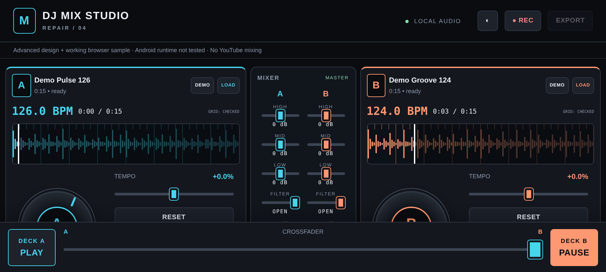
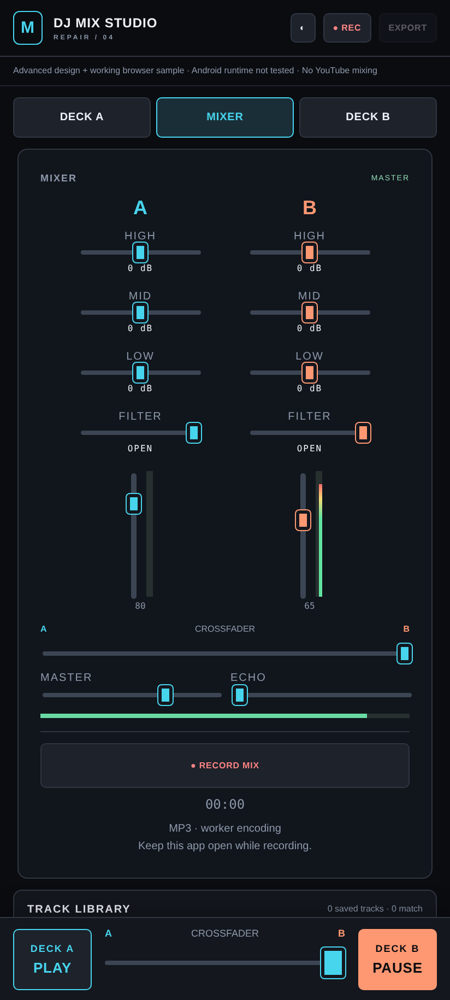
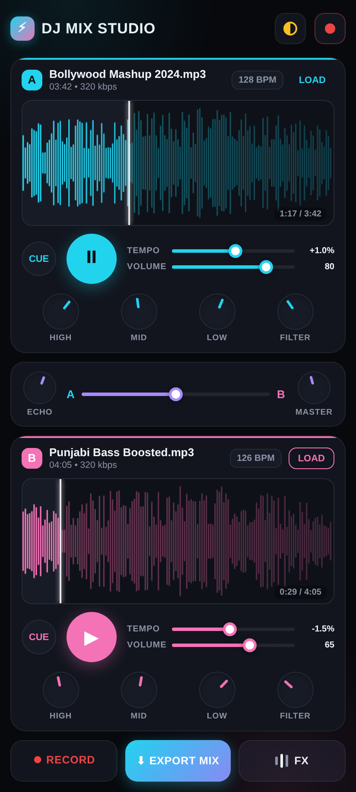
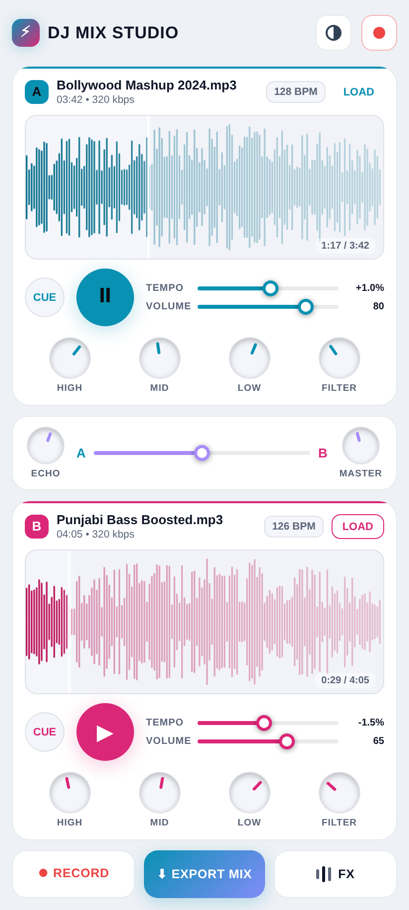
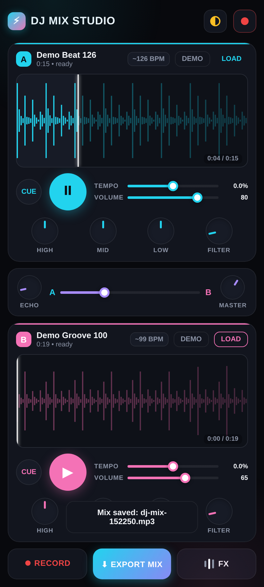

## Current repair preview: 0.4

[Android APK and exact source/test archive](https://github.com/AKASH991833/dj-mix-studio-app/releases/tag/v0.4-repair-preview)

This is a repair preview, **not Android-device-tested or live-gig ready**. It fixes library paging beyond 100 entries, overlapping same-deck loads, export state after a refused new recording, and phone access to both decks through persistent play/pause and crossfader controls. The full console still scrolls; this is not compact VirtualDJ parity. Native picker handling now owns pause policy, but the real Android picker/import/grants/local URI playback/Save As still need device testing.

Exact Android source, tests, synthesized fixture and screenshots are in the release asset `dj-repair-source-0.4.zip`, not GitHub's automatically generated Source code archives, which reflect the older website snapshot used by the tag. Older releases are unchanged.

Browser screenshots, not Android screenshots:





[Open the 0.4 browser sample](https://akash991833.github.io/dj-mix-studio-app/3-repair-preview.html). Still limited to 50 MB / 15 min per loaded track with whole-track memory decoding. No YouTube mixing, headphone cue output, stems or controller support.

---

# DJ Mix Studio

Free 2-deck DJ mixing app that runs in the browser (Android-first, installable as an APK wrapper later). Load your own songs, mix them live, and export the remix as an MP3 - no account, no server, no paid plan. Everything runs on the device.

**Live preview:** https://akash991833.github.io/dj-mix-studio-app/

## Features

- 2 decks: load your own audio files (MP3/WAV etc.) or tap DEMO for built-in practice beats
- Play / pause / cue, tap the waveform to seek
- TEMPO control (+-8%) with pitch compensation (SoundTouchJS audio worklet)
- HIGH / MID / LOW EQ knobs + FILTER sweep per deck
- A/B crossfader (equal-power), ECHO send, MASTER level
- 4-beat LOOP per deck
- Auto BPM estimate for loaded tracks
- RECORD your live mix and export it as a real MP3 file (WAV fallback)
- Dark and light themes, English UI, mobile portrait layout

## Screenshots





## Stack

- Plain HTML/CSS/JS, no framework
- Web Audio API (AudioContext + AudioWorklet) for the mixing engine
- [SoundTouchJS](https://github.com/cutterbl/SoundTouchJS) for tempo/pitch (MPL-2.0)
- [lamejs](https://github.com/zhuker/lamejs) for MP3 encoding (LGPL)
- Audio processing is local. This preview must first be loaded over HTTPS; persistent offline installation is not implemented yet.

## Run locally

Serve the folder over any static server and open it on your phone or browser:

```sh
python3 -m http.server 8080
# open http://localhost:8080
```

## Notes

- This preview does not mix YouTube/streaming audio: YouTube's official terms do not allow extracting or modifying the audio. This app mixes audio files you already have on your device.
- Tested in desktop Chrome (automated engine + UI tests). Android WebView device testing is the next step.

## Third-party licenses

SoundTouchJS is included without changes under MPL-2.0. Its bundled source appears in `11-app.js`; upstream source: https://github.com/cutterbl/SoundTouchJS .

lamejs is included without changes in `12-lame.min.js` under its upstream LGPL license. Corresponding source: https://github.com/zhuker/lamejs .

### SoundTouchJS MPL-2.0

```text
Mozilla Public License Version 2.0

This package is licensed under the terms of the Mozilla Public License, v. 2.0. If a copy of the MPL was not distributed with this file, You can obtain one at https://mozilla.org/MPL/2.0/.

Full license text: https://www.mozilla.org/en-US/MPL/2.0/

```
### lamejs license

```text
Can I use LAME in my commercial program?  

Yes, you can, under the restrictions of the LGPL.  The easiest
way to do this is to:

1. Link to LAME as separate jar (lame.min.js or lame.all.js)

2. Fully acknowledge that you are using LAME, and give a link
   to our web site, lame.sourceforge.net

3. If you make modifications to LAME, you *must* release these
   these modifications back to the LAME project, under the LGPL.

```
